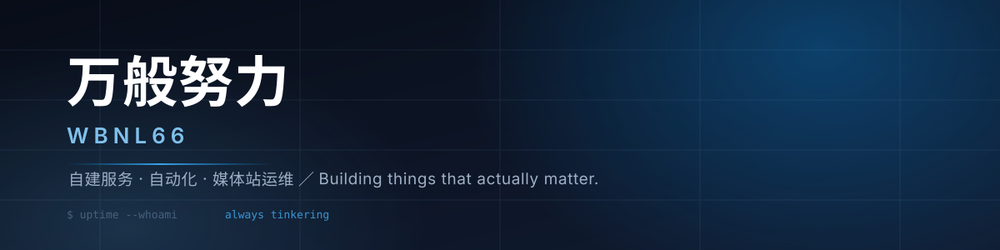

  

<!--
  以下内容全部以 HTML 注释隐藏，主页不渲染；
  源码保留，需要展示时把外层注释去掉即可。

  <h3>自建服务的折腾者 · <i>Self-hosting tinkerer</i></h3>
  

    把媒体站、机器人和运维面板一件件手搭起来 
    Building media servers, bots and ops panels one piece at a time
  

  

    
    
    
    
    
  

### 在折腾什么 · What I'm building

> 一条自洽的私有化链路：资源入库 → 会员准入 → 播放行为洞察 → 异常感知与干预。
> One self-contained private stack: ingestion → membership governance → playback insight → anomaly response.

<table>
  <tr>
    <td width="50%" valign="top">
      <b>🎬 EmbyBoss — 私有媒体调度中枢</b> 
      
        以 Telegram 机器人与小程序为交互面，承载邀请制准入、签到续期、额度与权限治理、观影榜 / 热播榜 / 实时在线态势；
        全异步 Python 服务端，事务幂等、状态可回放，把「谁在看什么、看了多久」变成可决策的数据。
        
      <i>An async Python control plane over a private media stack: invite-only admission, membership lifecycle, quota governance, and behavioural leaderboards driven by playback telemetry.</i>
    </td>
    <td width="50%" valign="top">
      <b>🧭 ChaPanda Panel — 可观测性与自愈</b> 
      
        健康巡检、跃迁式告警去抖（连续同态才定性）、多渠道通知聚合、IP 风险拦截看板；
        目标只有一个：把运维噪声压成信号，让异常在成为事故之前被看见。
        
      <i>Observability with intent: health probes, state-transition debouncing, multi-channel alert aggregation and IP risk forensics — noise in, signal out.</i>
    </td>
  </tr>
  <tr>
    <td width="50%" valign="top">
      <b>🌐 ChaPanda Site — 前端体验体系</b> 
      
        深色液态玻璃视觉语言，移动优先的排版节奏与滚动动效；
        多域名镜像保持像素级一致，把「同一个站」交付成「同一种体验」。
        
      <i>A dark glass-morphism design system with mobile-first typography, pixel-consistent across multi-domain mirrors.</i>
    </td>
    <td width="50%" valign="top">
      <b>🤖 Diga Group Bot — 社区治理引擎</b> 
      
        关键词语义响应、频道跟评策略、概率与冷却窗口调度、可视化群组策略编排；
        让规则可配置、行为可审计、社区可自持。
        
      <i>Community governance as configuration: keyword responses, channel-comment strategies, probabilistic scheduling and auditable policy.</i>
    </td>
  </tr>
</table>

---

### 干活习惯 · How I work

- **能自托管就自托管** —— Docker Compose + Nginx + SQLite，少一个外部依赖就少一个故障点。
- **先读日志再改代码** —— 大部分「玄学问题」都在日志里写着，告警降噪比加新功能更值钱。
- **改动必留回滚点** —— 备份、md5 校验、一键还原，是深夜里最好的保险。

### 联系 · Contact

有想法或问题，在本账号任意仓库开个 Issue 就好。 
Open an issue in any of my repositories — happy to talk.

 

  <code>$ uptime</code> — 保持折腾 · keep tinkering

-->
